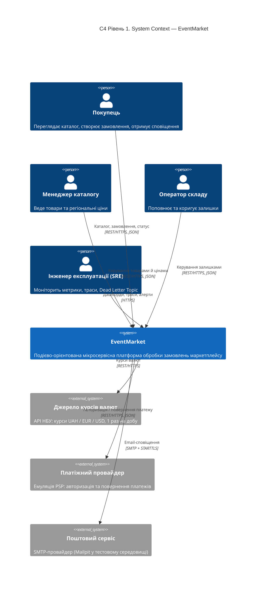
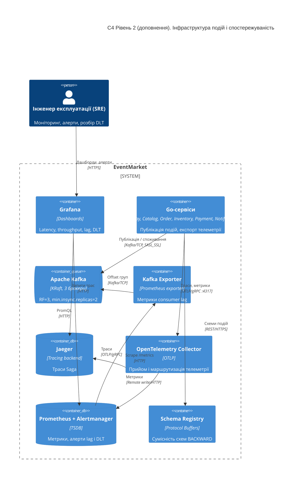

# РОЗДІЛ 2. ПРОЄКТУВАННЯ АРХІТЕКТУРИ

Навігація: [SRS](srs.md) · [ADR-001](adr/0001-choice-of-technology.md) · [Розділ 1](1_analysis.md) · [README](README.md)

Архітектуру спроєктовано за ієрархічною моделлю C4 (Simon Brown) на основі вимог [SRS](srs.md). Діаграми описано кодом Mermaid.js (Diagrams-as-Code) і рендеряться безпосередньо в GitHub та PKM Workspace. Елементи позначено в нотації C4: тип (`Person`, `Software System`, `Container`, `Component`), технологія та відповідальність. Кожен зв'язок містить протокол взаємодії.

> Нотація: нативний синтаксис C4 у Mermaid (`C4Context`, `C4Container`, `C4Component`; елементи `Person`, `System`, `System_Ext`, `Container`, `ContainerDb`, `ContainerQueue`, `Component`). Розміщення задано порядком оголошення елементів (сітка по 4 в рядку), положення підписів зв'язків — директивами `UpdateRelStyle`. Діаграми однаково рендеряться в GitHub на екранах шириною від 1280 px.

---

## 2.1 Контекстне та контейнерне моделювання системи (C4 Model)

### 2.1.1 C4 Рівень 1. System Context Diagram

**Опис вузлів і зв'язків**

| Вузол | Тип C4 | Роль | Протокол взаємодії | Вимоги |
|---|---|---|---|---|
| Покупець | Person | Перегляд каталогу, створення замовлення, перевірка статусу | REST/HTTPS, JSON | [SRS-FUN-04](srs.md#srs-fun-04), [SRS-FUN-08](srs.md#srs-fun-08), [SRS-FUN-10](srs.md#srs-fun-10) |
| Менеджер каталогу | Person | Ведення товарів і регіональних цін | REST/HTTPS, JSON | [SRS-FUN-07](srs.md#srs-fun-07) |
| Оператор складу | Person | Поповнення та коригування залишків | REST/HTTPS, JSON | [SRS-FUN-17](srs.md#srs-fun-17) |
| Інженер експлуатації (SRE) | Person | Моніторинг метрик, трас, Dead Letter Topic | HTTPS (Grafana, Jaeger) | [SRS-NFR-OBS-01](srs.md#srs-nfr-obs-01), [SRS-NFR-OBS-02](srs.md#srs-nfr-obs-02) |
| EventMarket | Software System | Прийняття замовлень та узгодження стану замовлень, залишків і платежів | — | [SRS, розд. 2](srs.md#2-контекст-системи-system-context) |
| Платіжний провайдер | Software System, Ext | Авторизація та повернення платежів (емуляція) | REST/HTTPS, JSON | [SRS-FUN-18](srs.md#srs-fun-18), [SRS-FUN-19](srs.md#srs-fun-19) |
| Джерело курсів валют (API НБУ) | Software System, Ext | Офіційні курси UAH/EUR/USD | REST/HTTPS, JSON | [SRS-FUN-05](srs.md#srs-fun-05) |
| Поштовий сервіс | Software System, Ext | Доставка email-сповіщень | SMTP + STARTTLS | [SRS-FUN-25](srs.md#srs-fun-25) |

### 2.1.2 C4 Рівень 2. Container Diagram (бізнес-потік)

```mermaid
%%{init: {"c4": {"width": 175, "diagramMarginX": 20}}}%%
C4Container
    title C4 Рівень 2. Container Diagram — EventMarket

    Person(customer, "Користувачі", "Ролі: customer, catalog_manager, warehouse_operator")

    System_Boundary(em, "EventMarket") {
        Container(spa, "Web SPA", "React, TypeScript", "Демонстраційний клієнт")
        Container(ingress, "Ingress Controller", "NGINX Ingress", "Термінація TLS, маршрутизація /v1 та /auth")
        Container(gateway, "API Gateway", "Go, Gin", "Перевірка JWT, маршрутизація, Rate Limiting")
        ContainerDb(gwRedis, "Rate Limit Store", "Redis", "Стан Token Bucket")

        Container(idp, "Identity Provider", "Keycloak, OIDC", "Видача JWT RS256, ролі RBAC")
        Container(catalog, "Catalog Service", "Go, gRPC", "Товари, регіональні ціни, курси")
        Container(order, "Order Service", "Go, gRPC", "Замовлення, ініціація Saga, Outbox")
        Container(inventory, "Inventory Service", "Go, gRPC", "Резервування залишків")

        ContainerDb(catalogDb, "Catalog DB", "PostgreSQL", "Товари, ціни, курси")
        ContainerDb(orderDb, "Order DB", "PostgreSQL", "orders, outbox, processed_events")
        ContainerDb(invRedis, "Stock Store", "Redis", "Залишки, Lua-скрипти")
        ContainerDb(invDb, "Inventory DB", "PostgreSQL", "reservations, outbox")

        Container(payment, "Payment Service", "Go", "Авторизація та повернення платежів")
        ContainerQueue(kafka, "Apache Kafka", "KRaft, 3 брокери", "Топіки Saga та DLT, RF=3")
        Container(notification, "Notification Service", "Go", "Сповіщення uk / en")
        ContainerDb(notifDb, "Notification DB", "PostgreSQL", "Статус доставки")

        ContainerDb(paymentDb, "Payment DB", "PostgreSQL", "payments, outbox")
    }

    Boundary(ext, "Зовнішні системи", "External") {
        System_Ext(fxProvider, "API НБУ", "Курси валют")
        System_Ext(paymentProvider, "Платіжний провайдер", "Емуляція PSP")
        System_Ext(mailProvider, "SMTP-провайдер", "Доставка email")
    }

    Rel(customer, spa, "Використовує", "HTTPS")
    Rel(spa, ingress, "API та вхід", "REST/HTTPS, OIDC")
    Rel(ingress, gateway, "Проксування /v1/*", "HTTP/1.1")
    Rel(ingress, idp, "Вхід: Code + PKCE", "OIDC/HTTP")
    Rel(gateway, idp, "Отримання JWKS", "HTTPS")
    Rel(gateway, gwRedis, "Token Bucket", "RESP/TCP")
    Rel(gateway, catalog, "Каталог, ціни", "gRPC/HTTP2")
    Rel(gateway, order, "Замовлення", "gRPC/HTTP2")
    Rel(gateway, inventory, "Залишки", "gRPC/HTTP2")
    Rel(order, catalog, "Читання цін", "gRPC/HTTP2")
    Rel(catalog, catalogDb, "Читання/запис", "SQL/TCP")
    Rel(order, orderDb, "Замовлення + outbox", "SQL/TCP")
    Rel(inventory, invRedis, "Резервування", "RESP/TCP, EVALSHA")
    Rel(inventory, invDb, "Резерви + outbox", "SQL/TCP")
    BiRel(order, kafka, "Події Saga", "Kafka/TCP, SASL_SSL")
    BiRel(inventory, kafka, "Події Saga", "Kafka/TCP, SASL_SSL")
    BiRel(payment, kafka, "Події Saga", "Kafka/TCP, SASL_SSL")
    Rel(kafka, notification, "Події статусу", "Kafka/TCP, SASL_SSL")
    Rel(notification, notifDb, "Статус доставки", "SQL/TCP")
    Rel(payment, paymentDb, "Платежі + outbox", "SQL/TCP")
    Rel(catalog, fxProvider, "Курси валют", "REST/HTTPS")
    Rel(payment, paymentProvider, "Авторизація / повернення", "REST/HTTPS")
    Rel(notification, mailProvider, "Надсилання листа", "SMTP + STARTTLS")

    UpdateRelStyle(spa, ingress, $offsetX="-50", $offsetY="-40")
    UpdateRelStyle(ingress, gateway, $offsetX="-30", $offsetY="-40")
    UpdateRelStyle(gateway, gwRedis, $offsetX="-25", $offsetY="-40")
    UpdateRelStyle(order, catalog, $offsetX="-35", $offsetY="-40")
    UpdateRelStyle(payment, kafka, $offsetX="-50", $offsetY="-45")
    UpdateRelStyle(kafka, notification, $offsetX="-50", $offsetY="-45")
    UpdateRelStyle(notification, notifDb, $offsetX="-30", $offsetY="-45")
    UpdateRelStyle(order, kafka, $offsetX="-110", $offsetY="70")
    UpdateRelStyle(inventory, kafka, $offsetX="60", $offsetY="95")
    UpdateRelStyle(inventory, invRedis, $offsetX="-20", $offsetY="-20")
    UpdateRelStyle(gateway, idp, $offsetX="20", $offsetY="-10")

    UpdateLayoutConfig($c4ShapeInRow="4", $c4BoundaryInRow="1")
```

**Опис контейнерів**

| Контейнер | Технологія | Відповідальність | Вимоги | Рішення |
|---|---|---|---|---|
| Web SPA | React, TypeScript | Демонстраційний клієнт; отримує токен за OIDC Authorization Code + PKCE | [SRS-NFR-SEC-01](srs.md#srs-nfr-sec-01) | — |
| Ingress Controller | NGINX Ingress | Термінація TLS 1.2+, єдина вхідна точка кластера | [SRS-NFR-SEC-02](srs.md#srs-nfr-sec-02) | — |
| Identity Provider | Keycloak (OIDC) | Видача JWT (RS256, TTL ≤ 15 хв), ролі `customer`, `catalog_manager`, `warehouse_operator` | [SRS-NFR-SEC-01](srs.md#srs-nfr-sec-01) | — |
| API Gateway | Go, Gin | Перевірка JWT за JWKS, маршрутизація `/v1/*`, Rate Limiting (Token Bucket у Redis) | [SRS-FUN-01](srs.md#srs-fun-01), [SRS-FUN-02](srs.md#srs-fun-02), [SRS-FUN-03](srs.md#srs-fun-03) | — |
| Catalog Service + Catalog DB | Go, gRPC; PostgreSQL | Товари, регіональні ціни, курси; gRPC-читання цін для Order Service (CQRS: окрема модель читання) | [SRS-FUN-04…07](srs.md#srs-fun-04), [SRS-NFR-PERF-03](srs.md#srs-nfr-perf-03) | — |
| Order Service + Order DB | Go, gRPC; PostgreSQL | Життєвий цикл замовлення, ініціація Saga, Transactional Outbox, Idempotency-Key | [SRS-FUN-08…13](srs.md#srs-fun-08), [SRS-FUN-21](srs.md#srs-fun-21), [SRS-NFR-PERF-02](srs.md#srs-nfr-perf-02) | [ADR-001](adr/0001-choice-of-technology.md) |
| Inventory Service + Stock Store + Inventory DB | Go, gRPC; Redis; PostgreSQL | Атомарне резервування Lua-скриптом, TTL резерву, синхронізація з PostgreSQL | [SRS-FUN-14…17](srs.md#srs-fun-14), [SRS-NFR-CONS-01](srs.md#srs-nfr-cons-01), [SRS-NFR-CONS-04](srs.md#srs-nfr-cons-04) | — |
| Payment Service + Payment DB | Go; PostgreSQL | Авторизація і повернення платежів, Circuit Breaker, ключ ідемпотентності `order_id` | [SRS-FUN-18…20](srs.md#srs-fun-18), [SRS-NFR-CONS-02](srs.md#srs-nfr-cons-02) | — |
| Notification Service + Notification DB | Go; PostgreSQL | Локалізовані сповіщення uk/en, дедуплікація за `event_id` | [SRS-FUN-25](srs.md#srs-fun-25) | — |
| Apache Kafka | KRaft, 3 брокери | Топіки `order.events`, `inventory.events`, `payment.events`, `*.dlt`; ключ партиціонування `order_id`; ≥ 12 партицій | [SRS-FUN-22…24](srs.md#srs-fun-22), [SRS-NFR-REL-02](srs.md#srs-nfr-rel-02), [SRS-NFR-SCAL-02](srs.md#srs-nfr-scal-02) | [ADR-001](adr/0001-choice-of-technology.md) |
| Rate Limit Store | Redis | Стан Token Bucket; ізольований від Stock Store | [SRS-FUN-03](srs.md#srs-fun-03) | — |

**Протоколи взаємодії**

| Від → До | Протокол | Призначення |
|---|---|---|
| Користувачі → Web SPA | HTTPS | Завантаження клієнта |
| Web SPA → Ingress Controller | REST / HTTPS (TLS 1.2+), JSON; OIDC | Виклики `/v1/*` з токеном `Authorization: Bearer`; вхід через `/auth/*` |
| Ingress Controller → API Gateway | HTTP/1.1 (у межах кластера) | Проксування `/v1/*` після термінації TLS |
| Ingress Controller → Identity Provider | OIDC / HTTP (у межах кластера) | Вхід за Authorization Code + PKCE |
| API Gateway → Identity Provider | HTTPS | Отримання та кешування JWKS |
| API Gateway → Rate Limit Store | RESP / TCP | Атомарне списання токенів bucket |
| API Gateway → Catalog / Order / Inventory | gRPC / HTTP2 | Синхронні команди та запити; передача `Idempotency-Key` і `traceparent` у metadata |
| Order Service → Catalog Service | gRPC / HTTP2 | Читання актуальних цін (лише читання) |
| Сервіси → власні БД | SQL / TCP (pgx) | Локальні ACID-транзакції, таблиці `outbox` і `processed_events` |
| Inventory Service → Stock Store | RESP / TCP (`EVALSHA`) | Атомарне резервування |
| Order / Inventory / Payment ↔ Kafka | Kafka protocol / TCP, SASL_SSL | Публікація подій relay-процесом, споживання подій Saga |
| Kafka → Notification Service | Kafka protocol / TCP, SASL_SSL | Події зміни статусу замовлення |
| Payment Service → Платіжний провайдер | REST / HTTPS | Авторизація та повернення |
| Catalog Service → API НБУ | REST / HTTPS | Курси валют |
| Notification Service → SMTP-провайдер | SMTP + STARTTLS | Надсилання листа |

**Потік Saga (choreography).** `OrderCreated` (Order) → `InventoryReserved` / `InventoryRejected` (Inventory) → `PaymentAuthorized` / `PaymentFailed` (Payment) → `OrderConfirmed` / `OrderCancelled` (Order). Компенсації: `InventoryReleased`, `PaymentRefunded`. Центральний координатор відсутній: кожен сервіс реагує на події зі свого топіка-джерела ([SRS-FUN-21](srs.md#srs-fun-21), [SRS-FUN-22](srs.md#srs-fun-22)).

### 2.1.3 C4 Рівень 2. Інфраструктура подій і спостережуваність

| Контейнер | Відповідальність | Протокол | Вимоги |
|---|---|---|---|
| Schema Registry | Реєстр схем подій Protocol Buffers, перевірка сумісності `BACKWARD` | REST / HTTPS | [SRS-NFR-QUAL-02](srs.md#srs-nfr-qual-02) |
| OpenTelemetry Collector | Прийом трас і метрик від сервісів, маршрутизація до Jaeger і Prometheus | OTLP / gRPC :4317 | [SRS-NFR-OBS-01](srs.md#srs-nfr-obs-01) |
| Kafka Exporter | Метрики consumer lag для Prometheus | Kafka / TCP; HTTP `/metrics` | [SRS-NFR-SCAL-01](srs.md#srs-nfr-scal-01) |
| Prometheus + Alertmanager | Зберігання метрик, алерти lag > 5 000 і приросту DLT | HTTP | [SRS-NFR-OBS-02](srs.md#srs-nfr-obs-02) |
| Jaeger | Зберігання трас, вимірювання тривалості Saga | OTLP / gRPC | [SRS-NFR-PERF-04](srs.md#srs-nfr-perf-04) |
| Grafana | Дашборди Latency, throughput, consumer lag, розмір DLT | HTTPS | [SRS-NFR-OBS-01](srs.md#srs-nfr-obs-01) |

---

## 2.2 Компонентне моделювання критичного сервісу системи

**Обраний сервіс:** Order Service ([C4 Container](#container-order-service)) — ініціатор Saga, власник Transactional Outbox і єдиний сервіс, що знаходиться на синхронному критичному шляху прийняття замовлення ([SRS-NFR-PERF-02](srs.md#srs-nfr-perf-02)). Внутрішня структура відповідає Clean Architecture: залежності спрямовані до доменного ядра, інфраструктурні адаптери реалізують порти (Go-інтерфейси) і впроваджуються через конструктори (Dependency Injection у `main`, composition root).

```mermaid
%%{init: {"c4": {"width": 175, "diagramMarginX": 20}}}%%
C4Component
    title C4 Рівень 3. Component Diagram — Order Service (Go, Clean Architecture)

    Container(gateway, "API Gateway", "Go, Gin", "Вхідні запити CreateOrder / GetOrder")

    Container_Boundary(svc, "Order Service") {
        Component(grpcServer, "gRPC Server", "grpc-go", "OrderAPI: CreateOrder, GetOrder")
        Component(authIc, "Auth Interceptor", "gRPC middleware", "Перевірка JWT, sub і ролей (Guard)")
        Component(validationIc, "Validation Interceptor", "protovalidate", "Валідація DTO, Idempotency-Key")
        Component(errorMapper, "Global Error Handler", "Recovery interceptor", "panic і доменні помилки → gRPC status")

        Component(getQ, "GetOrder Query", "Application", "Читання з перевіркою власника")
        Component(createUC, "CreateOrder Use Case", "Application", "PENDING + OrderCreated в одній транзакції")
        Component(sagaH, "Saga Reaction Handler", "Application", "CONFIRMED / CANCELLED, компенсації")
        Component(idemGuard, "Idempotency Guard", "Inbound", "Пропуск оброблених event_id")

        Component(portRepo, "OrderReader", "Port, Go interface", "Читання замовлень")
        Component(aggregate, "Order Aggregate", "Domain", "Інваріанти, машина станів")
        Component(portUow, "UnitOfWork", "Port, Go interface", "Транзакція: orders, outbox, processed_events")
        Component(portPrice, "PriceProvider", "Port, Go interface", "Актуальні ціни")

        Component(pgRepo, "PostgreSQL Reader", "pgx", "Реалізація OrderReader")
        Component(producer, "Kafka Producer", "IBM/sarama", "Idempotent, acks=all, key=order_id")
        Component(txm, "pgx Unit of Work", "pgx", "BEGIN / COMMIT, репозиторії в транзакції")
        Component(catClient, "Catalog gRPC Client", "grpc-go", "Timeout 300 мс, Circuit Breaker")

        Component(consumer, "Saga Event Consumer", "IBM/sarama ConsumerGroup", "inventory.events, payment.events")
        Component(retryDlt, "Retry / DLT Handler", "Inbound", "Backoff 100 мс × 2^n, 5 спроб")
        Component(relay, "Outbox Relay Worker", "goroutine", "FOR UPDATE SKIP LOCKED, пакет 100")
        Component(telemetry, "Telemetry", "OpenTelemetry SDK, slog", "Траси, метрики, журнал без PII")
    }

    Boundary(deps, "Залежності сервісу", "Containers") {
        ContainerQueue(kafka, "Apache Kafka", "KRaft", "order.events, *.dlt")
        ContainerDb(orderDb, "Order DB", "PostgreSQL", "orders, outbox, processed_events")
        Container(catalog, "Catalog Service", "Go, gRPC", "Ціни")
        Container(otel, "OpenTelemetry Collector", "OTLP", "Телеметрія")
    }

    Rel(gateway, grpcServer, "CreateOrder / GetOrder", "gRPC/HTTP2")
    Rel(grpcServer, authIc, "Ланцюжок", "unary interceptor")
    Rel(authIc, validationIc, "Ланцюжок", "unary interceptor")
    Rel(validationIc, errorMapper, "Помилки", "recover")
    Rel(validationIc, getQ, "GetOrder", "інтерфейс, DI")
    Rel(validationIc, createUC, "CreateOrder", "інтерфейс, DI")
    Rel(getQ, portRepo, "Читання", "інтерфейс")
    Rel(createUC, aggregate, "Створення", "виклик методу")
    Rel(createUC, portUow, "Транзакція", "інтерфейс")
    Rel(createUC, portPrice, "Ціни", "інтерфейс")
    Rel(sagaH, aggregate, "Переходи стану", "виклик методу")
    Rel(sagaH, portUow, "Транзакція", "інтерфейс")
    Rel(idemGuard, sagaH, "Нова подія", "інтерфейс, DI")
    Rel(pgRepo, portRepo, "Реалізує", "DIP")
    Rel(txm, portUow, "Реалізує", "DIP")
    Rel(catClient, portPrice, "Реалізує", "DIP")
    Rel(consumer, idemGuard, "Подія", "виклик функції")
    Rel(consumer, retryDlt, "Помилка обробки", "виклик функції")
    Rel(retryDlt, producer, "У DLT", "виклик функції")
    Rel(relay, producer, "Публікація", "виклик функції")
    Rel(kafka, consumer, "Fetch", "Kafka/TCP")
    Rel(producer, kafka, "Produce", "Kafka/TCP, SASL_SSL")
    Rel(pgRepo, orderDb, "SELECT", "SQL/TCP")
    Rel(txm, orderDb, "Транзакція", "SQL/TCP")
    Rel(relay, orderDb, "Вибірка outbox", "SQL/TCP")
    Rel(catClient, catalog, "GetPrices", "gRPC/HTTP2")
    Rel(telemetry, otel, "Експорт", "OTLP/gRPC")

    UpdateRelStyle(grpcServer, authIc, $offsetX="-35", $offsetY="-45")
    UpdateRelStyle(authIc, validationIc, $offsetX="-35", $offsetY="-45")
    UpdateRelStyle(validationIc, errorMapper, $offsetX="-25", $offsetY="-45")
    UpdateRelStyle(idemGuard, sagaH, $offsetX="-30", $offsetY="-45")
    UpdateRelStyle(consumer, retryDlt, $offsetX="-60", $offsetY="-50")
    UpdateRelStyle(createUC, portUow, $offsetX="-30", $offsetY="35")
    UpdateRelStyle(sagaH, aggregate, $offsetX="-70", $offsetY="-25")
    UpdateRelStyle(sagaH, portUow, $offsetX="10", $offsetY="-30")
    UpdateRelStyle(createUC, portPrice, $offsetX="110", $offsetY="10")
    UpdateRelStyle(consumer, idemGuard, $offsetX="-40", $offsetY="-10")
    UpdateRelStyle(producer, kafka, $offsetX="-90", $offsetY="30")
    UpdateRelStyle(pgRepo, orderDb, $offsetX="-30", $offsetY="85")
    UpdateRelStyle(txm, orderDb, $offsetX="-20", $offsetY="-30")
    UpdateRelStyle(relay, orderDb, $offsetX="95", $offsetY="-20")
    UpdateRelStyle(catClient, catalog, $offsetX="30", $offsetY="40")

    UpdateLayoutConfig($c4ShapeInRow="4", $c4BoundaryInRow="1")
```

**Опис компонентів**

| Шар | Компонент | Роль | Взаємодія | Вимоги |
|---|---|---|---|---|
| Inbound | gRPC Server | Реалізація `OrderAPI` (`CreateOrder`, `GetOrder`) | gRPC / HTTP2 від API Gateway | [SRS-FUN-08](srs.md#srs-fun-08), [SRS-FUN-10](srs.md#srs-fun-10) |
| Inbound | Telemetry Interceptor | Створює span (otelgrpc), метрики Latency, передає `trace_id` у контекст | Unary interceptor, перший у ланцюжку | [SRS-NFR-OBS-01](srs.md#srs-nfr-obs-01) |
| Inbound | Auth Interceptor | Повторна перевірка JWT (defense in depth), витяг `sub` і ролей у контекст | Unary interceptor | [SRS-NFR-SEC-01](srs.md#srs-nfr-sec-01), [SRS-NFR-SEC-03](srs.md#srs-nfr-sec-03) |
| Inbound | Validation Interceptor | Валідація DTO (protovalidate): кількість > 0, валюта ISO 4217, формат `Idempotency-Key` | Unary interceptor; помилка → `INVALID_ARGUMENT` | [SRS-NFR-SEC-03](srs.md#srs-nfr-sec-03) |
| Inbound | Recovery Interceptor + Global Error Mapper | Перехоплення panic; перетворення доменних помилок на gRPC status без розкриття внутрішніх деталей | Unary interceptor, останній у ланцюжку | [SRS-NFR-SEC-03](srs.md#srs-nfr-sec-03) |
| Inbound | Saga Event Consumer | Споживання `inventory.events`, `payment.events` (Sarama ConsumerGroup); фіксація offset після обробки | Kafka / TCP; виклик Idempotency Guard | [SRS-FUN-21](srs.md#srs-fun-21), [SRS-FUN-22](srs.md#srs-fun-22) |
| Inbound | Idempotency Guard | Перевірка `event_id` у `processed_events` у тій самій транзакції, що й зміна стану | Порт `IdempotencyStore` | [SRS-FUN-23](srs.md#srs-fun-23) |
| Inbound | Retry / DLT Handler | Повторні спроби 100 мс × 2ⁿ з jitter, 5 спроб, передача в `order.events.dlt` | Виклик Kafka Producer | [SRS-FUN-24](srs.md#srs-fun-24), [SRS-NFR-REL-03](srs.md#srs-nfr-rel-03) |
| Application | CreateOrder Use Case | Перевірка `Idempotency-Key`, отримання цін, створення агрегату, запис замовлення й `OrderCreated` в одній транзакції | Порти через DI | [SRS-FUN-08](srs.md#srs-fun-08), [SRS-FUN-09](srs.md#srs-fun-09), [SRS-FUN-12](srs.md#srs-fun-12) |
| Application | GetOrder Query | Читання замовлення з перевіркою `owner_id == sub` | Порт `OrderRepository` | [SRS-FUN-10](srs.md#srs-fun-10) |
| Application | Saga Reaction Handler | Застосування подій Saga до агрегату; запис наступної події або компенсації в outbox | Порти `TxManager`, `OrderRepository`, `OutboxWriter` | [SRS-FUN-21](srs.md#srs-fun-21), [SRS-FUN-22](srs.md#srs-fun-22) |
| Domain | Order Aggregate | Інваріанти та машина станів (`PENDING → CONFIRMED / CANCELLED`); не залежить від інфраструктури | Виклики методів агрегату | [SRS-FUN-11](srs.md#srs-fun-11) |
| Ports | `OrderRepository`, `OutboxWriter`, `TxManager`, `PriceProvider`, `IdempotencyStore` | Go-інтерфейси, оголошені в шарі application; забезпечують Dependency Inversion | Реалізуються адаптерами outbound | [SRS-NFR-QUAL-01](srs.md#srs-nfr-qual-01) |
| Outbound | PostgreSQL Repositories | Реалізація портів на pgx: `orders`, `outbox`, `idempotency_keys`, `processed_events` | SQL / TCP | [SRS-FUN-12](srs.md#srs-fun-12) |
| Outbound | pgx Tx Manager | Unit of Work: одна транзакція для бізнес-даних, outbox і `processed_events` | SQL / TCP | [SRS-FUN-12](srs.md#srs-fun-12), [SRS-NFR-CONS-03](srs.md#srs-nfr-cons-03) |
| Outbound | Catalog gRPC Client | Реалізація `PriceProvider`; timeout 300 мс, Circuit Breaker | gRPC / HTTP2 | [SRS-FUN-06](srs.md#srs-fun-06), [SRS-NFR-REL-04](srs.md#srs-nfr-rel-04) |
| Outbound | Outbox Relay Worker | Фонова goroutine: вибірка неопублікованих подій (`FOR UPDATE SKIP LOCKED`, пакет 100), публікація, позначка `published_at` після `acks=all` | SQL / TCP; виклик Kafka Producer | [SRS-FUN-13](srs.md#srs-fun-13), [SRS-NFR-PERF-05](srs.md#srs-nfr-perf-05) |
| Outbound | Kafka Producer | Sarama з `Idempotent=true`, `acks=all`, ключ `order_id`; заголовок `traceparent` | Kafka / TCP, SASL_SSL | [SRS-NFR-REL-02](srs.md#srs-nfr-rel-02), [ADR-001](adr/0001-choice-of-technology.md) |
| Cross-cutting | Telemetry (OpenTelemetry SDK, slog) | Траси, метрики, JSON-журнал з маскуванням PII | OTLP / gRPC до OTel Collector | [SRS-NFR-OBS-01](srs.md#srs-nfr-obs-01), [SRS-NFR-SEC-05](srs.md#srs-nfr-sec-05) |

**Обґрунтування взаємодії компонентів.**

1. **Dependency Inversion.** Use cases залежать лише від портів. Конкретні адаптери (pgx, grpc-go, Sarama) створюються в composition root і передаються через конструктори. Доменний шар не імпортує пакети інфраструктури; правило перевіряється лінтером `depguard` у golangci-lint.
2. **Відсутність подвійного запису.** Use case не викликає Kafka Producer напряму. Подія потрапляє в Kafka лише через `outbox` і Outbox Relay Worker ([SRS-FUN-12](srs.md#srs-fun-12), [SRS-FUN-13](srs.md#srs-fun-13)).
3. **Ідемпотентність на двох рівнях:** HTTP/gRPC-команди дедуплікуються за `Idempotency-Key`, події Kafka — за `event_id` у тій самій транзакції, що й зміна стану.
4. **Шлях читання.** `GetOrder` проходить через application-шар, щоб гарантувати перевірку власника ([SRS-FUN-10](srs.md#srs-fun-10), OWASP API1 BOLA).

---

## 2.3 Документування архітектурних рішень (Architecture Decision Records)

| ADR | Рішення | Статус | Вимоги-драйвери |
|---|---|---|---|
| [ADR-001](adr/0001-choice-of-technology.md) | Apache Kafka (KRaft) як брокер подій замість RabbitMQ і NATS JetStream | Approved | [SRS-NFR-REL-02](srs.md#srs-nfr-rel-02), [SRS-NFR-SCAL-02](srs.md#srs-nfr-scal-02), [SRS-NFR-CONS-03](srs.md#srs-nfr-cons-03), [SRS-FUN-13](srs.md#srs-fun-13) |

Контейнер [Apache Kafka](#container-kafka) на діаграмі Рівня 2 та компоненти [Outbox Relay Worker](#comp-outbox-relay) і [Saga Event Consumer](#comp-saga-consumer) на діаграмі Рівня 3 реалізують рішення [ADR-001](adr/0001-choice-of-technology.md).
